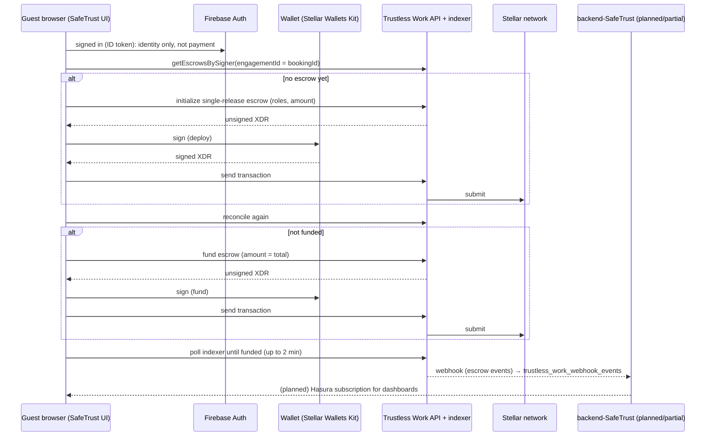

# Escrow architecture: Trustless Work and Stellar

Developer-facing companion to [How escrow payments work](help/escrow-explained.md).
It shows which components talk to which service, what is real today, and where
the code stops.

Verified against this repository at commit `ad2f38d7`. The booking state
machine and its safety rules are documented in
[`src/features/escrow/README.md`](../src/features/escrow/README.md); this page
does not repeat them.

## 1. Who talks to whom

### Text version of the same steps

1. The guest signs in with Firebase. The ID token proves identity to SafeTrust;
   it never authorizes a payment.
2. Before doing anything, the app asks the Trustless Work indexer for escrows
   whose signer is the connected wallet and whose `engagementId` is the
   booking id (`getEscrowsBySigner`, `validateOnChain: true`).
3. If no escrow exists, the app asks Trustless Work to initialize a
   **single-release** escrow with the booking amount and roles. The API returns
   an **unsigned** Stellar transaction (XDR).
4. The guest's wallet signs that XDR locally. The secret key never leaves the
   wallet and is never sent to SafeTrust or Trustless Work.
5. The app sends the signed transaction through Trustless Work, which submits
   it to Stellar.
6. The app reconciles with the indexer again before funding. If the escrow is
   not funded, it asks Trustless Work to build a fund transaction, the wallet
   signs, and Trustless Work submits it to Stellar.
7. While a step is submitted, the app polls the indexer every 5 seconds for up
   to 2 minutes. It offers no retry during that window.
8. Trustless Work emits escrow events. `backend-SafeTrust` receives the
   webhooks and persists them in `trustless_work_webhook_events`; the browser
   never receives a webhook.
9. Live dashboards are planned to read that state through a Hasura
   subscription. In this repository, `useEscrowSubscription` returns mock data.

## 2. Component boundaries

| Component                                         | File(s)                                                                                                                                                         | Status                                | Notes                                                                                                                                                                                                                                                                               |
| ------------------------------------------------- | --------------------------------------------------------------------------------------------------------------------------------------------------------------- | ------------------------------------- | ----------------------------------------------------------------------------------------------------------------------------------------------------------------------------------------------------------------------------------------------------------------------------------- |
| Booking escrow flow                               | `src/features/escrow/useBookingEscrow.ts`, `booking-escrow.machine.ts`                                                                                          | **Current**                           | Real Trustless Work API and wallet. Persists an intent in `sessionStorage`, reconciles before every action, never retries automatically.                                                                                                                                            |
| Checkout UI                                       | `src/features/escrow/BookingEscrowCheckout.tsx`                                                                                                                 | **Current**                           | Two wallet prompts, "Confirming on Stellar…", the recovery messages. Used by `/room` and `/hotels/[id]/book`.                                                                                                                                                                       |
| Pricing                                           | `src/features/escrow/pricing.ts`                                                                                                                                | **Current**                           | Sole source of the total: subtotal + tax + platform fee, computed in cents.                                                                                                                                                                                                         |
| Escrow configuration                              | `src/features/escrow/config.ts`                                                                                                                                 | **Current**                           | Platform wallet, dispute resolver, fee and tax rates, USDC trustline, poll timings, API URL and explorer links. The `/room` demo host payout wallet comes from `NEXT_PUBLIC_DEMO_HOST_WALLET_ADDRESS`; without it the booking UI refuses to start.                                  |
| Network selection                                 | `src/lib/stellar/network.ts`                                                                                                                                    | **Current**                           | `NEXT_PUBLIC_TRUSTLESS_NETWORK`, testnet by default. The Trustless Work API URL is derived from the same value, not from `NODE_ENV`.                                                                                                                                                |
| Wallet signing                                    | `src/lib/stellar/wallet-kit.ts`, `src/components/tw-blocks/wallet-kit/*`                                                                                        | **Current**                           | Stellar Wallets Kit; `signXdr` is the signing boundary. Wallet modules come from the kit's `allowAllModules`; Freighter is the default selection.                                                                                                                                   |
| Escrow providers                                  | `src/providers/EscrowProviders.tsx`, `src/app/room/page.tsx`, `src/app/hotels/[id]/book/HotelBookClient.tsx`, `src/components/booking/BookingEscrowWrapper.tsx` | **Current**                           | Mounted around the escrow component tree on each page that needs it; there is no longer a checkout route-group layout.                                                                                                                                                              |
| Firebase Auth                                     | `src/providers/AuthProvider.tsx`, `src/lib/auth/*`, `src/app/api/auth/wallet/*`                                                                                 | **Current**                           | Identity only. Wallet sign-in uses a server-verified SEP-10 challenge; auth does not authorize an escrow transaction.                                                                                                                                                               |
| Escrow status hook                                | `src/hooks/useEscrowSubscription.ts`                                                                                                                            | **Demo**                              | Returns a mock snapshot after 300 ms. The Apollo/Hasura subscription belongs to the dApp/backend, not this repo.                                                                                                                                                                    |
| Escrow dashboards and detail pages                | `src/app/dashboard/escrow/**`, `src/app/dashboard/escrow-dashboard/**`, `src/app/rent/[id]/escrow/[escrowId]/page.tsx`, `src/components/escrow/views/*`         | **Demo**                              | Stub escrow records (`getStubEscrow`), mock status and milestone data. The views render status; they do not move money.                                                                                                                                                             |
| Released-escrow claims                            | `src/features/escrow/claims.ts`, `src/app/api/escrow-claims/[escrowId]/route.ts`, `src/components/escrow/views/ClaimsPanel.tsx`                                 | **Current backend, demo-gated UI**    | Sends a claim to `backend-SafeTrust` through a Next proxy. `CLAIMS_AVAILABLE` is false in demo mode; the panel renders on the stub released-escrow view.                                                                                                                            |
| `/rent/[id]/escrow/create`                        | `src/app/rent/[id]/escrow/create/page.tsx`                                                                                                                      | **Demo / planned**                    | Renders a static "Booking Request Sent" screen and says escrow is not wired. The real checkout in this commit is `/room` and the hotel payment page that resumes its booking; wiring this route is tracked in [#587](https://github.com/safetrustcr/frontend-SafeTrust/issues/587). |
| Legacy booking escrow form                        | `src/components/booking/*`, `src/hooks/useBookingEscrow.ts`                                                                                                     | **Demo**                              | Stub booking data, a hardcoded 2.5% platform fee and a 70/30 milestone split. Not used by `features/escrow`; [#587](https://github.com/safetrustcr/frontend-SafeTrust/issues/587) removes it.                                                                                       |
| Trustless Work SDK mutation wrappers              | `src/components/tw-blocks/tanstack/useEscrowsMutations.ts`                                                                                                      | **Current plumbing / unused product** | Exposes deploy, fund, approve, change status, start dispute, release and resolve dispute. Only deploy and fund are called by the booking flow.                                                                                                                                      |
| Milestone approve / change-status blocks          | `src/components/tw-blocks/escrows/multi-release/*`                                                                                                              | **Planned**                           | Vendored components and tests only; not mounted on a product route.                                                                                                                                                                                                                 |
| Webhook ingestion and persistence                 | `backend-SafeTrust` (separate repository)                                                                                                                       | **Planned / partial, backend-owned**  | No webhook endpoint exists in this repo. `docs/SKELETON_ARCHITECTURE.md` and `docs/INTEGRATION_ROADMAP.md` define the contract.                                                                                                                                                     |
| Live escrow updates in the browser                | `dApp-SafeTrust` / Hasura                                                                                                                                       | **Planned**                           | Mock here; Apollo `useSubscription` in the production dApp.                                                                                                                                                                                                                         |
| Release, refund and dispute actions for a booking | none                                                                                                                                                            | **Planned**                           | Roles are configured at creation, but no route calls `releaseFunds`, `startDispute` or `resolveDispute`. Related roadmap items: IC-10, IC-11 and IC-14; the claims path above is IC-11.                                                                                             |

## 3. What the escrow contains

| Field            | Value in this code                                                                                                                     | Source                                              |
| ---------------- | -------------------------------------------------------------------------------------------------------------------------------------- | --------------------------------------------------- |
| Escrow type      | `single-release`, one milestone: "Stay completed without disputes"                                                                     | `buildDeployPayload` in `booking-escrow.machine.ts` |
| Idempotency key  | `engagementId === bookingId`; one booking has one escrow                                                                               | same                                                |
| Approver         | Guest wallet                                                                                                                           | same                                                |
| Service provider | Host payout wallet                                                                                                                     | same                                                |
| Receiver         | Host payout wallet                                                                                                                     | same                                                |
| Platform address | SafeTrust platform wallet from config                                                                                                  | same                                                |
| Release signer   | SafeTrust platform wallet from config                                                                                                  | same                                                |
| Dispute resolver | Address from config                                                                                                                    | same                                                |
| Amount           | `intent.amount`, equal to `computeBookingPrice().total`                                                                                | `pricing.ts`, `booking-escrow.machine.ts`           |
| Subtotal         | nightly rate × nights × guests                                                                                                         | `pricing.ts`                                        |
| Tax              | subtotal × `NEXT_PUBLIC_BOOKING_TAX_RATE` (default 0.1)                                                                                | `config.ts`                                         |
| Platform fee     | subtotal × `NEXT_PUBLIC_PLATFORM_FEE_PERCENT` ÷ 100 (default 5%), also sent to Trustless Work as the escrow's `platformFee` percentage | `config.ts`, `buildDeployPayload`                   |
| Asset            | USDC, via the network's USDC trustline from `trustlines.ts`                                                                            | `config.ts`                                         |
| Network          | `NEXT_PUBLIC_TRUSTLESS_NETWORK`, testnet by default                                                                                    | `src/lib/stellar/network.ts`                        |
| API base URL     | testnet → `https://dev.api.trustlesswork.com`; mainnet → `https://api.trustlesswork.com`                                               | `config.ts`                                         |

The total is the escrow amount: the app creates, funds and reconciles against
that one number. The client does not subtract the fee itself; it sends the full
total as `amount` and the percentage as `platformFee`, and the Trustless Work
contract applies the fee.

## 4. Why the flow looks like this

The invariants that keep money safe are listed once, in
[`src/features/escrow/README.md`](../src/features/escrow/README.md):

- reconcile with the indexer before every action;
- never deploy while an escrow exists for the booking id;
- never fund twice or fund a different amount;
- treat an error after submission as uncertain, not failed;
- poll for two minutes, and offer no automatic retry;
- one signer, one amount, one flow at a time.

The Trustless Work indexer is a read model, so it can lag the chain. That is
why a submitted step is resolved by polling and an on-chain validation, not by
trusting one response.

Two boundaries are worth repeating for integrators:

- **Webhooks do not reach this app.** Trustless Work event delivery terminates
  at `backend-SafeTrust`, which is the write authority. The browser's status
  data is mock in this repo and a Hasura subscription in the production dApp.
- **Trustless Work builds, the wallet signs, Trustless Work submits.** The API
  never receives a secret key; the app never submits a transaction without a
  wallet signature.

## 5. Open questions for maintainers

1. **Per-guest pricing.** `computeBookingPrice` multiplies
   `nightlyRate × nights × guests` (`pricing.ts`), and `BookingButton.tsx`
   documents its rate as "Price per night per guest". The behaviour is
   therefore deliberate in the code, not an accident. It is still a product
   question for whole-property rentals, where a nightly rate is usually per
   property: if the intended charge is `nightlyRate × nights`, this needs a
   behaviour change and an updated checkout breakdown, not only a docs change.
   No behaviour issue exists yet.
2. **Release and dispute have no product UI.** The SDK wrappers exist and the
   roles are configured, but no route calls `releaseFunds`, `startDispute` or
   `resolveDispute`. Released-escrow claims (IC-11) have a backend proxy and a
   panel, but the panel is demo-gated. Related roadmap items: IC-10, IC-11 and
   IC-14.
3. **Two checkout paths diverge.** `features/escrow` is the real flow;
   `/rent/[id]/escrow/create` and `/bookings/*/escrow` are stubs. Issue
   [#587](https://github.com/safetrustcr/frontend-SafeTrust/issues/587) covers
   consolidating them.
4. **SDK version.** `package.json` declares `@trustless-work/escrow ^2.0.8`;
   `package-lock.json` resolves **2.0.9**. The roles, deploy, fund and
   indexer calls used here are the single-release API documented below.

## 6. Sources

Accessed 22 October 2026. Trustless Work publishes both legacy (V1) and current
(V2) API pages; the links below are the pages used to check the roles and
lifecycle described here.

| Source                                                                                                                              | Used for                                                                 |
| ----------------------------------------------------------------------------------------------------------------------------------- | ------------------------------------------------------------------------ |
| [Trustless Work — Initialize escrow](https://docs.trustlesswork.com/trustless-work/api-rest/deploy/initialize-escrow)               | Single-release deploy payload, roles, unsigned XDR response              |
| [Trustless Work — Single release](https://docs.trustlesswork.com/trustless-work/api-rest/deploy)                                    | Single-release model and role responsibilities                           |
| [Trustless Work — Fund escrow](https://docs.trustlesswork.com/trustless-work/api-rest/deploy/fund-escrow)                           | `contractId`, `signer`, `amount`; funding is separate from deploy        |
| [Trustless Work — Release funds](https://docs.trustlesswork.com/trustless-work/api-rest/deploy/release-funds)                       | Only the release signer releases, after completion and outside a dispute |
| [Trustless Work — List escrows (V2)](https://docs.trustlesswork.com/trustless-work/v2-en/api-rest/escrow-information/list-escrows)  | Read model for escrows by participant; eventual consistency              |
| [Trustless Work — Escrow events](https://docs.trustlesswork.com/trustless-work/v2-en/api-rest/escrow-information/get-escrow-events) | On-chain event timeline; read/poll API, not webhooks                     |
| [Trustless Work — API introduction](https://docs.trustlesswork.com/trustless-work/api-rest/introduction)                            | Deploy, fund, approve, release and query endpoint groups                 |
| [Stellar — Networks](https://developers.stellar.org/docs/networks)                                                                  | Testnet vs mainnet and their passphrases                                 |
| [Stellar — Verify trustlines](https://developers.stellar.org/docs/build/guides/basics/verify-trustlines)                            | Trustline requirement for a non-native asset                             |
| [Stellar — x402 on Stellar](https://developers.stellar.org/docs/build/agentic-payments/x402)                                        | USDC as a Stellar asset; different issuers per network                   |
| [Stellar — Send and receive payments](https://developers.stellar.org/docs/build/guides/transactions/send-and-receive-payments)      | Signing, submission and polling for a final transaction status           |

Webhook delivery itself is not documented in the pages above. The contract for
this repository comes from
[`docs/SKELETON_ARCHITECTURE.md`](SKELETON_ARCHITECTURE.md) and
[`docs/INTEGRATION_ROADMAP.md`](INTEGRATION_ROADMAP.md): the backend owns
webhook validation and persistence, and the frontend never receives them.
